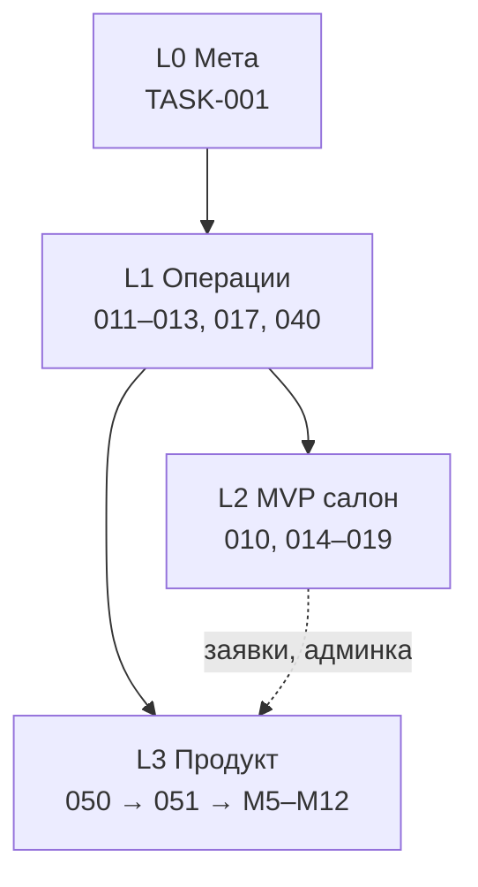

# Карта направлений NORTHCAT

> **Назначение:** одна точка входа — куда движется проект, что сделано, что делать дальше.  
> Каждая запись раскладывается до шагов в `tasks/TASK-*.md`, `bugs/`, `debt/`, `ideas/`.  
> **Обновлено:** 2026-06-14

**Связанные документы:**
- [INDEX.md](INDEX.md) — реестр всех ID
- [ROADMAP.md](ROADMAP.md) — фазы и milestones
- [PRODUCT-ROADMAP.md](PRODUCT-ROADMAP.md) — продуктовые карточки GitHub (#28–43)
- [PROPOSALS.md](PROPOSALS.md) — порядок работ и формулировки Todoist
- [NORTHCAT-REQUIREMENTS.md](../NORTHCAT-REQUIREMENTS.md) — полные требования продукта

---

## Выжимка последней сессии (14.06.2026)

За одну итерацию планирования зафиксировано:

| Что сделано | Где |
|-------------|-----|
| Аудит репозитория: баги, техдолг, пробелы | [INDEX.md](INDEX.md), [BACKLOG.md](../BACKLOG.md) |
| Система планирования `docs/project/` | [README.md](README.md), шаблоны `templates/` |
| 6/9 шагов TASK-001 (ROADMAP, INDEX, 15+ TASK-файлов) | [TASK-001](tasks/TASK-001-project-planning.md) |
| Требования продукта: примерочная + Gemini + PWA | [NORTHCAT-REQUIREMENTS.md](../NORTHCAT-REQUIREMENTS.md) |
| Решения владельца (аккаунты, Drive, почта, кешбек) | REQUIREMENTS § «Решения» |
| Продуктовая дорожная карта + GitHub issues #28–43 | [PRODUCT-ROADMAP.md](PRODUCT-ROADMAP.md) |
| Фазы 0–1 как TASK-050, TASK-051 | [TASK-050](tasks/TASK-050-product-phase0-foundation.md), [TASK-051](tasks/TASK-051-product-phase1-core.md) |
| Импорт production с GCP (`northcat-server`) | [PROJECT_MEMORY.md](../PROJECT_MEMORY.md), TASK-020 |
| Скрипты GitHub Project / карточек | `scripts/gh-create-project.sh`, `scripts/gh-create-product-cards.sh` |

**Главный вывод:** проект — **два параллельных трека**, которые сходятся в монорепо:

```
Трек A (операционный, июнь)     Трек B (продукт, июль+)
─────────────────────────────   ─────────────────────────
GCP sync → Docker fix           Фаза 0: виджет + прокси + БД
→ публикация → docs sync        Фаза 1: auth + кредиты + Gemini
→ дизайн 25.06                  Фаза 2–3: ТГ-админка, Drive, PWA
```

**Сейчас P0:** `TASK-020` → `TASK-011` → `TASK-012` → `TASK-013` (параллельно дизайн `TASK-017` / `TASK-040` до 25.06).

---

## Уровни проектов

Четыре уровня — от «как управлять» до «что строим как продукт».

| Уровень | Название | Горизонт | Смысл |
|---------|----------|----------|-------|
| **L0** | Мета-планирование | постоянно | Система учёта, ритуалы, приоритизация |
| **L1** | Операционный спринт | 14–28.06 | Починить infra, опубликовать, синхронизировать docs |
| **L2** | MVP салона | июль 2026 | Сайт + бот + API записей (legacy-трек) |
| **L3** | Продукт «Примерочная» | июль–окт 2026 | Виджет, Gemini, аккаунты, биллинг, PWA |



---

## Шесть направлений (блоки)

Каждый блок: **✅ сделано** · **🔴 P0** · **🟡 P1** · **💡 идеи** · **⚠️ проблемы**

---

### 1. 📋 Планирование и документация (L0)

**Цель:** любая задача имеет ID, шаги, метрики, связь с Todoist/GitHub.

| Тип | ID | Статус | Детали |
|-----|-----|--------|--------|
| ✅ Задача | TASK-001 S1–S6 | done | Структура `docs/project/`, ROADMAP, INDEX, 15 TASK, 3 IDEA, шаблоны |
| 🔄 Задача | TASK-001 S7–S9 | active | Weekly ritual, Todoist sync, пометка BACKLOG |
| 🔴 Задача | TASK-013 | backlog | README/PROJECT_MAP ≠ фактический стек → [файл](tasks/TASK-013-sync-documentation.md) |
| ⚠️ Долг | DEBT-001 | open | Документация описывает Next.js, код — static/Python |

**Процесс достижения (TASK-001):**
1. S7 — добавить чеклист четверга в `AI_MANAGEMENT.md`
2. S8 — создать 3 карточки Todoist по формату `TASK-NNN` из [PROPOSALS.md](PROPOSALS.md)
3. S9 — в `BACKLOG.md` указать «актуальный реестр → INDEX»

**Как анализировать любую задачу:**
```
ID → tasks/TASK-NNN.md → шаги S1..Sn → depends_on / blocks → definition_of_done
```

---

### 2. 🏗️ Инфраструктура (L1 → L2)

**Цель:** monorepo поднимается локально и на GCP; CI проверяет сборку.

| Тип | ID | Статус | Детали |
|-----|-----|--------|--------|
| ✅ | Импорт GCP | done | `services/website/`, `services/tg-bot/` (коммиты 9911bc6, 0ad1a8c) |
| ✅ | Docker website | частично | nginx+Caddy есть, путь к боту сломан |
| 🔴 | TASK-020 | backlog | Выгрузка GCP → `import/` → merge → [файл](tasks/TASK-020-gcp-sync-workflow.md) |
| 🔴 | BUG-001 + TASK-011 | backlog | `./bot/` → `../tg-bot/` → [файл](tasks/TASK-011-fix-monorepo-docker.md) |
| 🟡 | TASK-010 | blocked | Root docker-compose → [файл](tasks/TASK-010-docker-local-dev.md) |
| 🟡 | TASK-014 | backlog | CI build+smoke → [файл](tasks/TASK-014-ci-build-smoke.md) |
| ⚠️ | GAP-004 | open | Нет root `docker-compose.yml` / `package.json` |
| ⚠️ | DEBT-002 | open | CI без build/lint/test |

**Процесс (критический путь):**

| Шаг | Действие | Время | Результат |
|-----|----------|-------|-----------|
| TASK-020/S1 | `gcloud auth` + `gcp-pull-production.sh` | 30 мин | `import/gcp-production/` |
| TASK-020/S2 | `gcp-diff-production.sh`, правки | 1–2 ч | diff-отчёт |
| TASK-020/S3 | rsync в `services/website`, `services/tg-bot` | 1 ч | актуальный код в репо |
| TASK-011/S1 | Исправить context/dockerfile в compose | 30 мин | BUG-001 закрыт |
| TASK-011/S4 | `docker compose up` — :8080 + бот | 15 мин | локальный стек |
| TASK-010 | Root compose: web + bot + (postgres) | 2 ч | GAP-004 закрыт |
| TASK-014 | GitHub Actions: build images + smoke | 2–3 ч | DEBT-002 закрыт |

---

### 3. 🌐 Сайт northcat.top (L1 → L2)

**Цель:** production static site с реальным контентом, HTTPS, Mini App TON.

| Тип | ID | Статус | Где в коде |
|-----|-----|--------|------------|
| ✅ | Static MVP | ~90% | `services/website/` |
| ✅ | NFT-генератор | done | `services/website/` |
| 🟡 | Mini App TON | нужен адрес | `miniapp.html` |
| 🔴 | TASK-012 | backlog | Ключи, контент, HTTPS → [файл](tasks/TASK-012-production-readiness.md) |
| 🟡 | TASK-018 | backlog | Заявки в API вместо localStorage → [файл](tasks/TASK-018-bookings-backend.md) |
| 🟡 | TASK-019 | backlog | Серверная защита admin.html → [файл](tasks/TASK-019-admin-security.md) |
| ⚠️ | DEBT-003 | open | Заявки в `localStorage` |
| ⚠️ | DEBT-004 | open | Пароль админки на клиенте |
| 💡 | IDEA-001 | P2 | Next.js vs static — **решено: остаёмся static** |

**Процесс TASK-012 (публикация):**

| # | Шаг | Кто | Файл/действие |
|---|-----|-----|---------------|
| 1 | BOT_TOKEN, OPERATOR_CHAT_ID | владелец | `services/tg-bot/.env` |
| 2 | STUDIO_TON_ADDRESS | владелец | `miniapp.html` |
| 3 | Реальные контакты | владелец | `js/data.js` |
| 4 | Фото работ/скетчей | владелец | `ресурсы/` |
| 5 | Домен + HTTPS | infra | Caddy на GCP `34.13.167.104` |
| 6 | BotFather Menu Button | владелец | URL miniapp |
| 7 | `tonconnect-manifest.json` | проверка | по HTTPS |
| 8 | nginx auth для admin | dev | TASK-019 |

---

### 4. 🤖 Telegram-бот (L1 → L2 → L3)

**Цель:** aiogram-бот для заявок → затем полноценный клиент + админка продукта.

| Тип | ID | Статус | Где |
|-----|-----|--------|-----|
| ✅ | aiogram 3 scaffold | ~70% | `services/tg-bot/` |
| ✅ | `/start`, `/menu`, `/setup` | done | handlers |
| 🔴 | TASK-012 | backlog | `.env` + production check |
| 🟡 | TASK-030 legacy | mostly done | команды MVP |
| 📅 | M9 (продукт) | phase 2 | бот + Mini App + deep-links (#36) |
| 📅 | M10 (продукт) | phase 2 | админка в боте (#37) |

**Два этапа бота:**

```
Этап 1 (L2, июль):     заявки → БД, /book, /portfolio
Этап 2 (L3, август+):  баланс, коды, фото, админка, inline
```

**Процесс этапа 1:**
1. TASK-016 — миграция `appointments`
2. TASK-015 — `POST /api/appointments`
3. TASK-018 — сайт шлёт на API вместо localStorage
4. Бот: `/book` → state machine → запись в БД

---

### 5. 🎨 Дизайн и бренд (L1)

**Цель:** VISUAL_IDENTITY + экспорт ассетов к **25.06.2026**.

| Тип | ID | Статус | Дедлайн |
|-----|-----|--------|---------|
| 🟡 | Canva candidate | in progress | [Canva](https://www.canva.com/d/1WIUhM7eGyk1FpF) |
| 🔴 | TASK-017 | backlog | **25.06** → [файл](tasks/TASK-017-visual-identity.md) |
| 🔴 | TASK-040 | backlog | **25.06** → [файл](tasks/TASK-040-export-design-assets.md) |
| ⚠️ | GAP-003 | open | Нет `docs/VISUAL_IDENTITY.md` |
| 💡 | — | note | Кириллица в Pirata One → fallback шрифт |

**Процесс TASK-017 → TASK-040:**

| Шаг | Действие | Артефакт |
|-----|----------|----------|
| S1 | Зафиксировать цвета `#f4587e`, `#0c120e`, типографику | `docs/VISUAL_IDENTITY.md` |
| S2 | Логотип: 3+ варианта (full, icon, mono) | `resources/design/` |
| S3 | Иконки, паттерны, sacred geometry | PNG/SVG |
| S4 | Экспорт из Canva: PNG/SVG/PDF | `resources/design/` |
| S5 | Обновить сайт: favicon, og:image | `services/website/` |

---

### 6. 💼 Продукт «Примерочная» (L3)

**Цель:** единый монорепо — сайт + виджет + Gemini proxy + аккаунты + биллинг.

Источник: [NORTHCAT-REQUIREMENTS.md](../NORTHCAT-REQUIREMENTS.md)

#### Фаза 0 — Foundation (TASK-050, июль)

| Карточка | Модуль | Статус | Шаги |
|----------|--------|--------|------|
| #28 P0-1 | Node + PostgreSQL | backlog | Зафиксировать стек backend |
| #29 P0-2 | Монорепо + перенос | backlog | `frontend/` + `backend/` |
| #30 P0-3 | БД users/sessions/events | backlog | TASK-016 |
| #3 | GCP sync | backlog | TASK-020 |
| #4 | Docker fix | backlog | TASK-011 |

**Процесс TASK-050:**

```
S1 TASK-020 (GCP merge)
  → S2 получить исходники виджета + прокси от владельца
  → S3 создать frontend/ backend/ infra/
  → S4 виджет → frontend/fitting-room/
  → S5 прокси → backend/gemini-proxy/
  → S6 TASK-016 миграции
  → S7 docker compose: web + api + postgres + bot
```

**Definition of Done:** виджет и прокси в репо, PostgreSQL с миграциями, compose поднимает весь стек.

#### Фаза 1 — Core M1–M4 (TASK-051, август)

| Карточка | Модуль | Ключевое | Блокер |
|----------|--------|----------|--------|
| #31 | M1 Аккаунты | Google + TG + Passkey | OAuth credentials |
| #32 | M2 Кредиты | Коды оператора, активация | номиналы пакетов |
| #33 | M3 Прокси Gemini | Валидация in/out, billing | Gemini API key |
| #34 | UI | Подтверждения, чек-листы | — |
| #35 | M4 Логи | events table | tg_id админов |

**Правило биллинга (M3):** кредит списывается **только** за успешную генерацию (изображение + quality check + no safety-block). До 3 бесплатных ретраев.

#### Фаза 2 — Telegram + Storage (сентябрь)

| # | Модуль | Содержание |
|---|--------|------------|
| #36 | M9 | Бот: фото, баланс, коды, Mini App |
| #37 | M10 | Админка в Telegram |
| #38 | M5 | Google Drive владельца |
| #39 | M6 | Шеринг `/v/{id}` + deep-link в бот |

#### Фаза 3 — Notifications + Loyalty + PWA (октябрь+)

| # | Модуль | Содержание |
|---|--------|------------|
| #40 | M7 | Почта на домене northcat.top |
| #41 | M8 | Рефералы + кешбек баллами |
| ~~#42~~ | M11 | **Отменено** — шаблоны размещений |
| #43 | M12 | PWA manifest + service worker |
| #44 | — | VIP, автоплатёж, PDF/SVG — **отложено** |

#### L2 Salon API (параллельный трек, июль)

| ID | Статус | Связь с L3 |
|----|--------|------------|
| GAP-001 + TASK-015 | backlog | MVP API записей; позже сольётся с backend/ |
| GAP-002 + TASK-016 | backlog | Первая миграция — общая для salon + product |

---

## Матрица типов записей

| Тип | Когда | Пример | Куда смотреть процесс |
|-----|-------|--------|----------------------|
| **TASK** | Конкретная работа с шагами | TASK-011 | `tasks/TASK-011-*.md` |
| **BUG** | Сломано сейчас | BUG-001 | `bugs/BUG-001-*.md` |
| **DEBT** | Работает, но риск | DEBT-003 | `debt/DEBT-003-*.md` |
| **GAP** | Компонент отсутствует | GAP-002 | `debt/GAP-002-*.md` |
| **IDEA** | На обсуждение | IDEA-003 | `ideas/IDEA-003-*.md` |

**Формула приоритета:** `(U×3 + I×3 + R×2 + D×2) − (C×1.5)` — см. [README.md](README.md)

---

## ✅ Выполненный план (зафиксировано)

### Система планирования (TASK-001)

- [x] S1 — `docs/project/` + README + 5 шаблонов
- [x] S2 — `ROADMAP.md` с фазами и ссылками
- [x] S3 — `INDEX.md` реестр
- [x] S4 — IDEA-001, 002, 003 из IDEAS.md
- [x] S5 — импорт P0/P1: TASK-010…020, 040, 050, 051
- [x] S6 — шаблоны BUG/DEBT/GAP/IDEA/TASK

### Аудит и документация (14.06)

- [x] Аудит репозитория → BUG-001, DEBT-001…004, GAP-001…004
- [x] `NORTHCAT-REQUIREMENTS.md` — требования продукта
- [x] `PRODUCT-ROADMAP.md` — карточки #28–43
- [x] Решения владельца (OAuth, Drive, почта, PWA, отмена M11)
- [x] `PROJECT_MEMORY.md` — GCP + LuxHost + скрипты sync
- [x] `PROPOSALS.md` — порядок TASK-020 → 011 → 012 → 013
- [x] GitHub issues + milestones (скрипт `github-roadmap-setup.sh`)

### Код и инфраструктура (до аудита)

- [x] Static website ~90% — `services/website/`
- [x] NFT-генератор
- [x] Mini App TON (нужен адрес)
- [x] TG-bot aiogram 3 — `/start`, `/menu`, `/setup`
- [x] Docker nginx + Caddy (пути monorepo сломаны)
- [x] Импорт production с GCP в репо
- [x] Скрипты: `gcp-pull-production.sh`, `gcp-diff-production.sh`, `gcp-list-vms.sh`
- [x] LuxHost API workflow `.github/workflows/luxhost-check.yml`

### Отменено / не делаем в спринте

- [x] ~~Next.js~~ — production static, IDEA-001 отложена
- [x] ~~telegraf~~ — используем aiogram 3
- [x] ~~M11 шаблоны размещений~~ — отменено владельцем

---

## 🔴 Что делать прямо сейчас

### Неделя 14–20 июня

| Приоритет | ID | Действие | Оценка |
|-----------|-----|----------|--------|
| 1 | TASK-020 | Выгрузка GCP, diff, merge | 1–3 ч |
| 2 | TASK-011 | Починить docker-compose (BUG-001) | 1–2 ч |
| 3 | TASK-012 | Ключи бота, TON, контент data.js | 2–4 ч |
| 4 | TASK-013 | README = static + Python bot | 1–2 ч |
| 5 | TASK-017 | VISUAL_IDENTITY.md | 3–5 ч |
| 6 | TASK-040 | Экспорт Canva → resources/design | 2–4 ч |

### Неделя 21–28 июня

| ID | Действие |
|----|----------|
| TASK-010 | Root docker-compose monorepo |
| TASK-014 | CI build + smoke |
| TASK-001 S7–S9 | Закрыть мета-планирование |

### Июль → август (после L1)

```
TASK-050 (Фаза 0) → TASK-051 (Фаза 1)
параллельно: TASK-016 → TASK-015 → TASK-018 → TASK-019
```

---

## Вопросы к владельцу (блокируют L3)

| # | Вопрос | Блокирует |
|---|--------|-----------|
| 1 | Исходники виджета + прокси Gemini (путь/репо) | TASK-050 S2 |
| 2 | DNS northcat.top: LuxHost или GCP? Почта: приём/отправка? | M7 |
| 3 | Номиналы пакетов, % кешбека, бонус рефералу | M2, M8 |
| 4 | BOT_TOKEN, tg_id админов | TASK-012, M10 |
| 5 | Google Drive: личный или студийный аккаунт | M5 |
| 6 | Доступ к серверу для полного аудита | TASK-050 S1 |

---

## Как направлять проект (ритуал)

**Еженедельно (четверг):**
1. Открыть этот файл + [INDEX.md](INDEX.md)
2. Проверить P0 — что закрыто, что блокируется
3. Обновить статусы в TASK-*.md
4. Создать/обновить Todoist (`TASK-NNN`, `dueString`)
5. Обновить [PROJECT_MEMORY.md](../PROJECT_MEMORY.md)

**Команды для AI:**
- «Что делать дальше?» → PROPOSALS порядок 020→011→012→013
- «Разложи TASK-050» → открыть файл, показать S1–S7
- «Статус продукта» → PRODUCT-ROADMAP + REQUIREMENTS
- «Что сделано?» → секция «Выполненный план» выше

**GitHub доска:**
```bash
gh auth refresh -s project,read:project
./scripts/gh-create-project.sh
```

---

## Навигация по деталям

| Нужно | Файл |
|-------|------|
| Все ID и статусы | [INDEX.md](INDEX.md) |
| Фазы и milestones | [ROADMAP.md](ROADMAP.md) |
| Продуктовые карточки | [PRODUCT-ROADMAP.md](PRODUCT-ROADMAP.md) |
| Порядок + Todoist | [PROPOSALS.md](PROPOSALS.md) |
| Требования M1–M13 | [NORTHCAT-REQUIREMENTS.md](../NORTHCAT-REQUIREMENTS.md) |
| Инфра GCP/LuxHost | [PROJECT_MEMORY.md](../PROJECT_MEMORY.md) |
| Спринт-чеклист | [BACKLOG.md](../BACKLOG.md) |
| Шаблон новой задачи | [templates/task.md](templates/task.md) |

---

**Версия:** 1.0 · **Автор обновления:** AI + аудит 14.06.2026
