# Продуктовая дорожная карта NORTHCAT (карточки)

> Источник: `tmp.txr` / [docs/NORTHCAT-REQUIREMENTS.md](../NORTHCAT-REQUIREMENTS.md)
> Карточки = GitHub Issues с меткой `track/product`. Доска: GitHub Project «NORTHCAT Roadmap».
> **Обновлено:** 2026-06-14

---

## Что уже готово (из репозитория)

| Компонент | Статус | Где |
|-----------|--------|-----|
| Сайт (static HTML/JS) | ✅ ~90% | `services/website/` |
| Telegram-бот (aiogram 3) | 🟡 ~70% (нужны ключи) | `services/tg-bot/` |
| Mini App (TON) + NFT-генератор | 🟡 готовы, нужен TON-адрес/HTTPS | `services/website/` |
| Docker (nginx+Caddy+bot) | 🟡 пути monorepo сломаны | BUG-001 |
| Виджет примерочной | ❌ вне репо | перенос — P0-2 |
| Прокси Gemini | ❌ вне репо | перенос — P0-2 |
| PostgreSQL / аккаунты / биллинг | ❌ нет | Фаза 0–1 |

---

## Этапы → milestones → карточки

```mermaid
flowchart LR
  subgraph P0["Product P0: Foundation"]
    A1["#28 P0-1 стек Node+PG"]
    A2["#29 P0-2 монорепо + перенос виджета/прокси"]
    A3["#30 P0-3 БД users/sessions/events"]
    A0["#3 GCP sync · #4 docker fix"]
  end
  subgraph P1["Product P1: Core"]
    B1["#31 M1 аккаунты"]
    B2["#32 M2 кредиты/коды"]
    B3["#33 M3 прокси Gemini"]
    B4["#34 UI подтверждения"]
    B5["#35 M4 логи"]
  end
  subgraph P2["Product P2: Telegram + Storage"]
    C1["#36 M9 бот"]
    C2["#37 M10 админка"]
    C3["#38 M5 Google Drive"]
    C4["#39 M6 шеринг"]
  end
  subgraph P3["Product P3: Notifications + Loyalty + PWA"]
    D1["#40 M7 почта"]
    D2["#41 M8 рефералы/кешбек"]
    D3["#42 M11 шаблоны"]
    D4["#43 M12 PWA"]
  end
  P0 --> P1 --> P2 --> P3
```



### Product P0: Foundation (milestone #6)

| # | Карточка | Area | Приоритет |
|---|----------|------|-----------|
| #28 | P0-1: Стек backend (Node + PostgreSQL) | backend | P0 |
| #29 | P0-2: Монорепо + перенос виджета и прокси Gemini | backend/frontend | P0 |
| #30 | P0-3: БД + миграции users/sessions/events | database | P0 |
| #3 | TASK-020: GCP sync → import/ → merge | infra | P0 |
| #4 | TASK-011: Починить Docker/monorepo (BUG-001) | infra | P0 |

### Product P1: Core — auth + billing + proxy (milestone #7)

| # | Карточка | Модуль | Приоритет |
|---|----------|--------|-----------|
| #31 | Аккаунты: Google OAuth, TG Login, Passkey | M1 | P0 |
| #32 | Кредиты и коды оплаты | M2 | P0 |
| #33 | Прокси Gemini + валидация + ретраи + идемпотентность | M3 | P0 |
| #34 | UI: подтверждения + чек-листы | §3.2 | P1 |
| #35 | Логирование событий | M4 | P1 |

### Product P2: Telegram + Storage (milestone #8)

| # | Карточка | Модуль | Приоритет |
|---|----------|--------|-----------|
| #36 | Telegram бот (фото, баланс, коды, Mini App, deep-links) | M9 | P0 |
| #37 | Админка в Telegram | M10 | P0 |
| #38 | Хранилище Google Drive | M5 | P1 |
| #39 | Шеринг /v/{id} + связка с ботом | M6 | P1 |

### Product P3: Notifications + Loyalty + PWA (milestone #9)

| # | Карточка | Модуль | Приоритет |
|---|----------|--------|-----------|
| #40 | Почта (свой домен на сервере) + письма | M7 | P1 |
| #41 | Рефералы + кешбек баллами (за тату/товары) | M8 | P1 |
| ~~#42~~ | ~~Шаблоны размещений~~ — **отменено** | M11 | — |
| #43 | PWA (manifest, SW, иконки) | M12 | P2 |

### Отложено (milestone — нет, метка `status/deferred`)

| # | Карточка | Когда |
|---|----------|-------|
| #44 | VIP, автоплатёж, экспорт PDF/SVG/TIFF | VIP — напомнить после Фазы 1–2 |

---

## Как открыть доску с карточками (GitHub Project)

Интеграционный токен **не может создать Project-board** (`Resource not accessible by integration`).
Создай доску под своим аккаунтом — один раз:

```bash
# дать gh права на проекты
gh auth refresh -s project,read:project

# создать доску «NORTHCAT Roadmap» и добавить все карточки track/product
./scripts/gh-create-project.sh
```

Скрипт:
1. создаёт Project v2 «NORTHCAT Roadmap»;
2. добавляет все issues с меткой `track/product` (#28–43);
3. добавляет ключевые задачи Фазы 0 (#3, #4, #16).

После создания вручную (1 раз) настрой на доске:
- поле **Status**: Todo / In progress / Done;
- группировку по **Milestone** (Product P0–P3) — получишь колонки-фазы;
- доп. поля при желании: Priority, Area.

### Альтернатива через веб-интерфейс

1. github.com → твой профиль → **Projects** → **New project** → Board.
2. **Add items** → отфильтровать `label:track/product` → добавить все.
3. Group by → Milestone.

---

## Решено (14.06.2026)

Аккаунты (TG+Google+Passkey), логирование на сайте, Google Drive владельца, шеринг+ТГ-ссылка,
своя почта на домене, кешбек за покупки, бот+Mini App+inline+админка, PWA. M11 отменён.
VIP/автоплатёж/экспорт — отложены (#44). Подробно — `docs/NORTHCAT-REQUIREMENTS.md` «Решения».

## Осталось уточнить (для точного плана)

1. **Доступ к серверу** — владелец предоставит для аудита реализованного.
2. **Домен/почта:** DNS northcat.top — LuxHost (`31.76.118.165`) или GCP (`34.13.167.104`)? Приём писем или только отправка? PTR?
3. **Биллинг:** цена пакета, число генераций, % кешбека, бонус рефералу.
4. **Telegram:** `BOT_TOKEN`, список `tg_id` админов.
5. **Google Drive:** личный аккаунт владельца или отдельный студийный?

---

**Карточки:** issues #28–43 · **Milestones:** #6–9 · **Метка:** `track/product`
