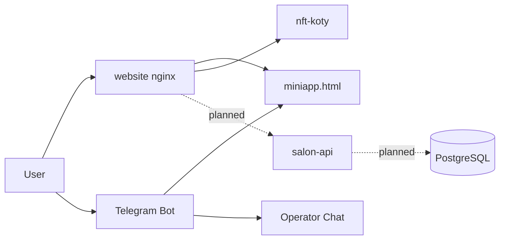

# IDEA-003: Architecture diagram

## Суть

BACKLOG P0 просит architecture diagram. Сейчас связи между сервисами только в тексте.

## Что показать

## Где положить

- `docs/architecture.md` или секция в README
- Mermaid в git (рендер на GitHub)

## Оценка

1–2 ч

## Если принято → TASK-022 (создать при принятии)
